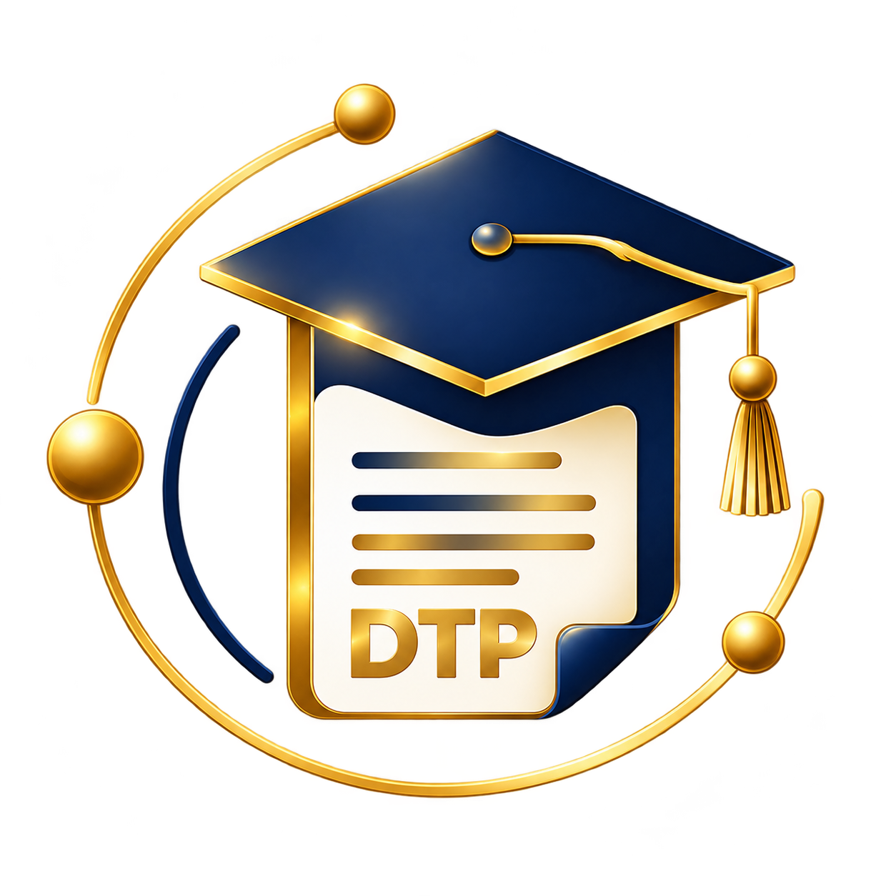
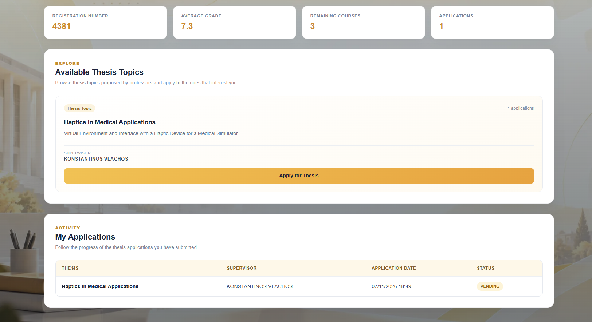

<div align="center">

<!-- LOGO PATH: Verify the filename against src/main/resources/static/images/ before publishing. -->


# Diploma Portal

### University Thesis Management System

**Java 17 · Spring Boot 4.1.1 · Spring Security · Thymeleaf · SQLite · HTML · CSS · JavaScript**

A role-based platform for managing university diploma theses, from topic publication and student applications to assignments, submissions, and grading.

[Overview](#overview) · [Features](#core-features) · [Technology](#technology-stack) · [Screenshots](#application-screenshots) · [Getting Started](#getting-started)

</div>

---

## Overview

**Diploma Portal** is a full-stack web application that brings students, professors, and university administrators into a single thesis-management workflow. It uses server-side rendering with Thymeleaf, Spring MVC for web requests, Spring Security for access control, and SQLite for local persistence.

Students discover and apply for thesis topics, professors supervise assignments and evaluate submissions, and administrators manage accounts and related academic records.

## Core Features

| Module | Capabilities |
| --- | --- |
| **Authentication & authorization** | Secure login, BCrypt password hashing, role-based access control, and role-aware dashboards. |
| **Student portal** | Profile management, topic browsing, applications, application history, assigned-thesis details, PDF submission, and grade viewing. |
| **Professor portal** | Topic creation and management, application reviews, student assignment, supervision, submission review, and grading. |
| **Administration** | Student and professor account management, coordinated deletion of related records, and confirmation prompts for destructive operations. |
| **Assignment strategies** | Configurable approaches for choosing a student for a thesis. |
| **File handling** | Profile-picture uploads and replacement of submitted thesis PDFs, stored outside the application classpath. |

### Student Workflow

1. Register or sign in and complete the student profile.
2. Browse available thesis topics and apply to a preferred topic.
3. Monitor application status and access assignment details when selected.
4. Upload or replace the completed thesis PDF.
5. View the final grading result.

The system limits duplicate applications for the same topic and prevents further applications after a thesis has been assigned.

### Professor Workflow

1. Create and maintain thesis topics.
2. Review applications for each topic.
3. Select a student using an assignment strategy.
4. Track supervised students and review submitted PDFs.
5. Enter separate grades for **implementation**, **report**, and **presentation**, with automatic final-grade calculation.

### Thesis Assignment Strategies

The assignment feature applies the **Strategy design pattern**, separating selection logic from MVC controllers.

| Strategy | Selection approach |
| --- | --- |
| Random Choice | Selects a student randomly among eligible applicants. |
| Best Average Grade | Favors the applicant with the highest academic average. |
| Fewest Remaining Courses | Favors the applicant with the fewest outstanding courses. |
| Grade & Remaining Courses Threshold | Evaluates eligibility against defined academic thresholds. |

## Technology Stack

| Layer | Technology |
| --- | --- |
| Language | Java 17 |
| Backend | Spring Boot 4.1.1, Spring Web MVC |
| Authentication | Spring Security, BCrypt |
| Views | Thymeleaf, reusable template fragments |
| Persistence | Spring Data JPA, Hibernate |
| Database | SQLite |
| Validation | Jakarta Validation |
| Frontend | HTML5, CSS3, vanilla JavaScript |
| Build & dependencies | Maven, Maven Wrapper |

## Architecture & Implementation

Diploma Portal follows a layered design that separates HTTP request handling, business rules, and persistence:

```text
Browser / Thymeleaf Views
           |
           v
     MVC Controllers
           |
           v
     Service Layer ------> Assignment Strategies
           |
           v
  Spring Data Repositories
           |
           v
      SQLite Database
```

**Additional implementation details:**

- Three access roles: `ADMIN`, `PROFESSOR`, and `STUDENT`.
- Registration and profile-completion checks before role-specific operations.
- Dedicated service logic for account deletion and related-record cleanup.
- Local runtime storage for profile images and thesis files.
- Server-rendered UI without a frontend JavaScript framework.

## Project Structure

```text
DiplomaPortal/
├── .mvn/wrapper/
├── data/                           # Local SQLite database directory
├── docs/screenshots/               # Application screenshots
├── src/
│   └── main/
│       ├── java/com/kkargas/diplomaportal/
│       │   ├── config/
│       │   ├── controller/
│       │   ├── dto/
│       │   ├── enums/
│       │   ├── interceptor/
│       │   ├── model/
│       │   ├── repository/
│       │   ├── security/
│       │   ├── service/
│       │   └── strategy/
│       └── resources/
│           ├── static/             # CSS, JS, images
│           ├── templates/          # Thymeleaf views
│           └── application.properties
├── uploads/                        # Local runtime files
├── mvnw
├── mvnw.cmd
└── pom.xml
```

## Application Screenshots

The repository provides a `docs/screenshots/` folder for application captures. This section can be completed with the actual screenshots once their filenames have been verified.

Suggested gallery order:

1. Login and registration
2. Student dashboard and thesis topic browsing
3. Thesis applications and assignment status
4. Professor dashboard and assignment strategy selection
5. Thesis PDF submission and grading
6. Administrator dashboard

<!-- Example after confirming the exact filename:
### Student Dashboard

-->

## Getting Started

### Prerequisites

- **JDK 17** or newer.
- Internet access for the first Maven Wrapper execution (to retrieve build dependencies).

### Clone the repository

```bash
git clone https://github.com/KonKargas/DiplomaPortal.git
cd DiplomaPortal
```

### Run the application

**Windows**

```bat
mvnw.cmd spring-boot:run
```

**macOS / Linux**

```bash
chmod +x mvnw
./mvnw spring-boot:run
```

Open **http://localhost:8080** in a web browser.

### Run tests

```bash
./mvnw test
```

On Windows, use `mvnw.cmd test` instead.

## Local Data & Uploads

The default SQLite database is stored at:

```text
data/diploma-portal.db
```

Hibernate is configured to update the database schema automatically (`spring.jpa.hibernate.ddl-auto=update`). The local database is excluded from version control.

Uploaded data is stored under:

```text
uploads/student-profile-pictures/
uploads/professor-profile-pictures/
uploads/thesis-pdfs/
```

Configured multipart limits are **10 MB per file** and **12 MB per request**. Uploaded files are not intended to be committed to the repository.

### Development Administrator Account

On first startup, the current local-development initializer creates an administrator when one does not already exist:

```text
Username: admin
Password: admin123
```

> **Security:** These credentials are for local development only. Replace the default credentials and secure the initialization flow before any public deployment. Do not expose an instance with the demo account enabled.

Students and professors can register through the application or be created by an administrator.

## Repository Scope

The repository contains the Spring Boot application source, server-rendered templates, frontend assets, Maven build configuration, and an area for screenshots. Local database contents and user-uploaded files are runtime data rather than distributable project assets.

The project is intended as a portfolio and educational demonstration of layered web application development, role-based workflows, persistence, and configurable selection algorithms.

---

## Author

**Konstantinos Kargas**  
Full-Stack Software Engineer

- Website: [kkargas.com](https://kkargas.com)
- GitHub: [KonKargas](https://github.com/KonKargas)

---

*Diploma Portal — streamlined thesis management, transparent student assignments, and structured academic workflows.*
