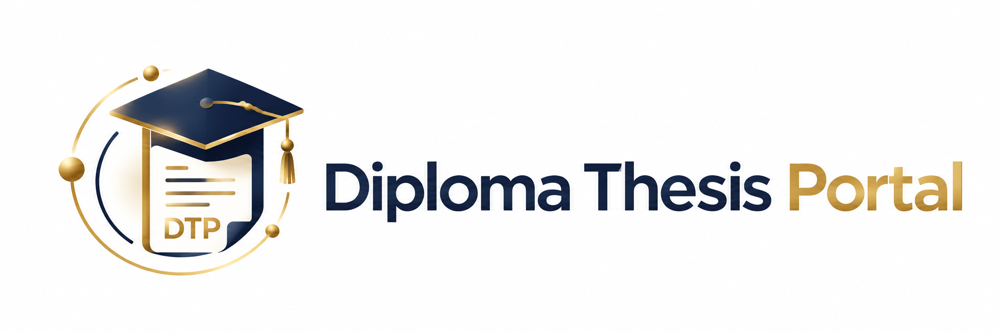

<div align="center">



# Diploma Portal

**A role-based diploma thesis management system built with Spring Boot, Thymeleaf and SQLite.**

</div>

## Overview

Diploma Portal is a university thesis-management web application that supports the complete workflow between **students**, **professors**, and **administrators**.

Professors can publish thesis topics, review student applications, assign a student using configurable selection strategies, supervise submissions, and grade completed theses. Students can manage their profile, browse available topics, apply for a thesis, follow their applications, and upload the final thesis PDF. Administrators manage student and professor accounts from a dedicated dashboard.

The project uses server-side rendering with Thymeleaf and a traditional Spring MVC architecture, with no frontend framework required.

## Features

### Authentication & authorization

- Spring Security authentication with BCrypt password hashing
- Three roles: `ADMIN`, `PROFESSOR`, and `STUDENT`
- Role-based route protection
- Student and professor self-registration
- Profile-completion enforcement before accessing role-specific functionality
- Password visibility toggle on login and registration forms

### Student portal

- Student profile management
- Profile-picture upload
- Browse available thesis topics
- Submit one application per thesis topic
- Prevent new applications after receiving a thesis assignment
- View application history and status
- View assigned thesis information
- Upload or replace the final thesis PDF
- View thesis grading results

### Professor portal

- Professor profile management
- Profile-picture upload
- Create, edit, and delete thesis topics
- Review applications for each thesis
- Assign one student to a thesis using multiple strategies
- View students under supervision
- View submitted thesis PDFs
- Grade implementation, report, and presentation
- Automatic final-grade calculation

### Assignment strategies

The application implements the Strategy pattern for thesis assignment:

- **Random Choice**
- **Best Average Grade**
- **Fewest Remaining Courses**
- **Grade & Remaining Courses Threshold**

### Administration

- Dedicated admin dashboard
- Create, edit, and delete student accounts
- Create, edit, and delete professor accounts
- Related applications and assignments are cleaned up during account deletion
- Deleting a professor also removes their thesis topics and related thesis data
- Confirmation prompts protect destructive delete operations

## Tech Stack

| Layer | Technology |
| --- | --- |
| Language | Java 17 |
| Backend | Spring Boot 4.1.1 |
| MVC | Spring Web MVC |
| Security | Spring Security |
| Templates | Thymeleaf |
| Persistence | Spring Data JPA / Hibernate |
| Database | SQLite |
| Validation | Jakarta Validation |
| Frontend | HTML5, CSS3, vanilla JavaScript |
| Build | Maven / Maven Wrapper |

## Architecture

The application follows a conventional layered Spring architecture:

```text
Controller
    ↓
Service
    ↓
Repository
    ↓
SQLite Database
```

Thesis assignment selection is separated behind a strategy interface and factory, allowing assignment algorithms to remain independent from controller logic.

## Project Structure

```text
src/main/java/com/kkargas/diplomaportal/
├── config/          # Security, MVC configuration, admin initialization
├── controller/      # MVC controllers
├── dto/             # Form and request DTOs
├── enums/           # Roles, statuses and strategy types
├── interceptor/     # Profile completion guards
├── model/           # JPA entities
├── repository/      # Spring Data repositories
├── security/        # UserDetails service
├── service/         # Business logic
└── strategy/        # Thesis assignment strategies

src/main/resources/
├── static/
│   ├── css/
│   ├── images/
│   └── js/
├── templates/
│   ├── admin/
│   ├── auth/
│   ├── dashboard/
│   ├── fragments/
│   ├── professor/
│   └── student/
└── application.properties
```

## Getting Started

### Requirements

- JDK 17 or newer
- Internet access on first Maven Wrapper run to download Maven/dependencies

### Clone the repository

```bash
git clone <your-repository-url>
cd DiplomaPortal
```

### Run on Windows

```powershell
mvnw.cmd spring-boot:run
```

### Run on macOS / Linux

```bash
chmod +x mvnw
./mvnw spring-boot:run
```

Then open:

```text
http://localhost:8080
```

## Database

The application uses a local SQLite database:

```text
data/diploma-portal.db
```

The database file is intentionally excluded from Git. Hibernate creates/updates the schema automatically with:

```properties
spring.jpa.hibernate.ddl-auto=update
```

The empty `data/` directory is retained in the repository so SQLite can create the database on first launch.

## Default Admin Account

On first startup, the project creates a local administrator account if one does not already exist:

```text
Username: admin
Password: admin123
```

> **Security note:** These credentials are intended only for local development/demo use. Change the initializer or provide a stronger credential mechanism before deploying the application publicly.

Student and professor accounts can be created through the registration page or by an administrator.

## Uploaded Files

Runtime uploads are stored outside the classpath under:

```text
uploads/student-profile-pictures/
uploads/professor-profile-pictures/
uploads/thesis-pdfs/
```

Uploaded user files are intentionally excluded from Git.

The current multipart limits are:

```text
Maximum file size:    10 MB
Maximum request size: 12 MB
```

## Screenshots

A `docs/screenshots/` directory is included for repository screenshots. Suggested captures include:

- Login / registration
- Student dashboard
- Professor dashboard
- Admin dashboard
- Thesis applications and assignment strategy selection
- Thesis submission and grading

## Running Tests

```bash
./mvnw test
```

On Windows:

```powershell
mvnw.cmd test
```

## Notes

- The application is designed as a portfolio/university project and uses a local SQLite database for straightforward setup.
- Uploaded files and the local database are runtime data and are not version controlled.
- The UI is implemented with Thymeleaf, reusable HTML fragments, CSS, and small vanilla JavaScript utilities.

## Author

**Konstantinos Kargas**

Java / Spring Boot Software Developer

---

If you find the project useful, feel free to explore the source code and adapt it for educational purposes.
